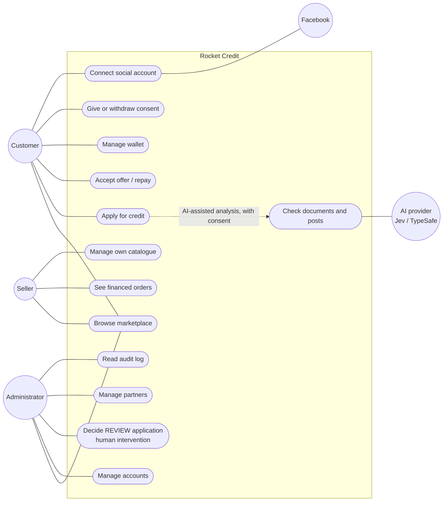
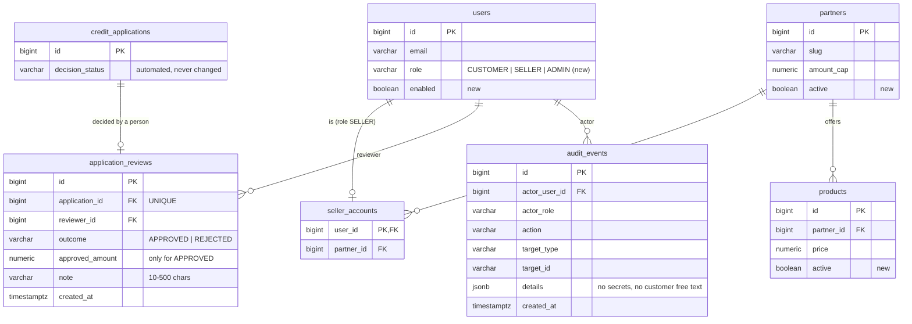

<!-- AI-assisted (Claude), 2026; reviewed by the author. -->
# Roles: use cases and data model

See [ROLES.md](ROLES.md) for the rules behind these diagrams.

## Use cases

Mermaid has no UML use-case diagram, so actors are drawn as rounded nodes and use cases as ellipses (`([...])`).

## New tables (V17)

`application_reviews` and `audit_events` are append-only (triggers refuse `UPDATE` and `DELETE`).
