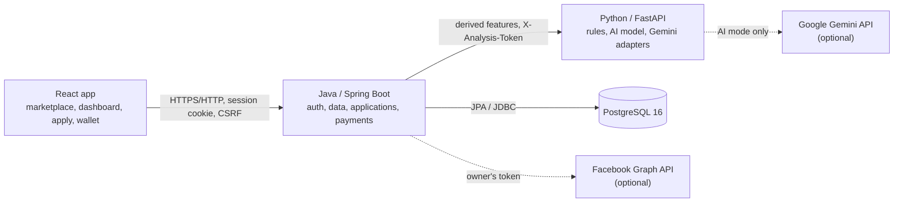
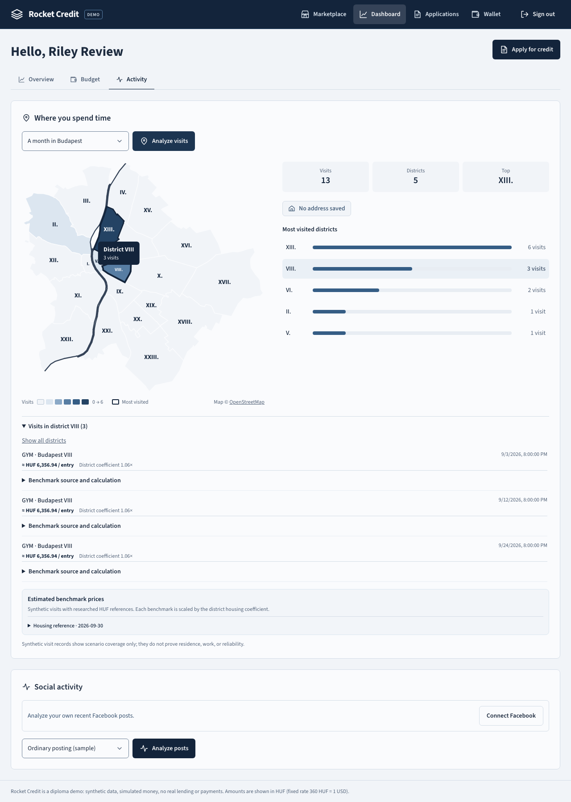

# A Credit Decision Web Application: Authentication, Multithreading, Modular Scoring, Safe Data Keeping and AI Analysis

Diploma thesis draft — Rocket Credit project. Version of 22 October 2026.

---

## Abstract

This thesis presents Rocket Credit, a small "buy now, pay in parts" web application built to study five software
engineering topics in one working system: authentication, multithreading, modular scoring, safe data keeping and
AI-based analysis. A customer browses a marketplace of three demo sellers, requests credit for a product or an
amount, chooses a repayment plan and receives an instant, explained decision. The system consists of a React
frontend, a Java/Spring Boot backend that owns all data, a stateless Python scoring service and one PostgreSQL
database, started together with Docker Compose.

Each topic is implemented and then evaluated. Session-based authentication with BCrypt, CSRF protection and
ownership checks is verified by 10 authentication tests and cross-user access tests. Three independent
feature-preparation tasks run on a bounded thread pool; parallel preparation produced identical results in
1,300 runs and was about 2.9 times faster (median 2.07 ms → 0.72 ms) on local data and 3.0 times faster under
simulated I/O delay. The scoring service separates profile rules, seller-history rules, an affordability formula
and a decision combiner, each returning reason codes that the interface turns into plain language. A logistic-
regression model trained on 5,569 synthetic applications raised the ranking quality of the decision score from
ROC-AUC 0.707 (rules) to 0.801 (rules + AI) on 1,200 held-out customers and increased the approval rate from 32 % to
40 % with the same 0.5 % default rate among approved applications. Generative AI (Google Gemini) is used only for
explanation tasks — reading a synthetic address card, extracting cost figures and describing social-media
activity — with schema and evidence checks and a rule-based fallback.

All data is synthetic and the money is simulated. The results describe this prototype and its dataset, not real
credit risk.

---

## 1. Introduction

### 1.1 Motivation

Point-of-sale credit ("buy now, pay later") is now a common way to pay online. A decision has to be fast, it has to
be correct for the person who asks, and it has to be explainable: a customer who is declined should understand why.
Behind such a product are several classic engineering problems — who is the user, how to compute a decision quickly
from several data sources, how to combine rules into one result, how to keep personal data safe, and where machine
learning helps. A small but complete application is a good laboratory for these problems because each mechanism can
be observed, tested and measured in context.

### 1.2 Objective

The objective is to build and explain a full-stack credit decision prototype and to use it to answer five research
questions:

1. **Authentication.** How do password hashing, server-side sessions and ownership checks protect account data?
2. **Multithreading.** How does a bounded thread pool affect independent feature preparation compared with
   sequential execution, and which correctness risks must be controlled?
3. **Modular scoring.** How can separate rule modules produce an understandable credit decision and amount limit?
4. **Safe data keeping.** Which storage and access controls are sufficient to demonstrate responsible handling of a
   prototype's user data?
5. **AI analysis.** How does a simple trained model compare with rules alone on a fixed synthetic dataset, and how
   can its contribution be explained? Where do generative models add value, and how can they be kept safe?

### 1.3 Contributions

- A working application that an examiner can start with one command and use in the browser (Chapter 3,
  [demo script](DEMO_SCRIPT.md)).
- For each topic: an implementation, the controls around it, automated tests, and a measured or demonstrated result.
- Reproducible experiments: AI training and evaluation (`research/training/`) and the multithreading benchmark
  (`research/benchmarks/`).
- A user interface designed for short reading: one marketplace, a decision-first result page and a Budapest district
  map that shows where a customer spends time (Chapter 9).

### 1.4 Structure

Chapter 2 sets the requirements and scope. Chapter 3 describes the architecture. Chapters 4–8 cover the five research
topics: authentication (4), data keeping (5), scoring (6), AI (7) and multithreading (8). Chapter 9 describes the user
interface, Chapter 10 the verification, Chapter 11 the limitations and Chapter 12 concludes.

---

## 2. Requirements and scope

### 2.1 Functional requirements

| ID | Requirement |
| --- | --- |
| F1 | A customer can register, sign in and sign out. |
| F2 | The customer sees their own purchase history with three demo sellers (Netflix, Amazon, Zara catalogs). |
| F3 | The customer browses one marketplace with all sellers' products. |
| F4 | The customer requests credit for a product or a custom amount and chooses 1–3 weekly or 1–24 monthly payments. |
| F5 | The system returns a saved decision — approved, not approved or needs review — with reasons and a possible amount. |
| F6 | The customer can optionally include an AI risk estimate in the decision. |
| F7 | An approved request becomes credit only when the customer accepts the repayment plan. |
| F8 | The customer can see an affordable amount based on income, debts and living costs for their Budapest district. |
| F9 | The customer can analyse a (synthetic) visit history on a district map and, optionally, their own Facebook posts. |

### 2.2 Non-functional requirements

| ID | Requirement |
| --- | --- |
| N1 | Customers can never read another customer's data. |
| N2 | Passwords and third-party tokens are never stored or returned in plain text. |
| N3 | A failed analysis never produces a fake decision; it is a technical error. |
| N4 | The decision, its inputs and the policy/model versions are stored together so results can be explained later. |
| N5 | Independent work runs concurrently without changing results. |
| N6 | Everything starts locally with Docker Compose; no external service is required (AI providers are optional). |
| N7 | The interface works on a phone and with a keyboard; pages are short and plain. |

### 2.3 Out of scope

Real banks and payment providers, real identity checks, human review of inconclusive decisions, merchant onboarding,
distributed infrastructure and any claim of real credit-risk accuracy. All customer data, histories and visit records
are synthetic; Budapest rent and grocery prices are researched public figures (Section 6.4).

---

## 3. Architecture

### 3.1 Components



| Component | Responsibility | Technology |
| --- | --- | --- |
| Frontend (`demo-repository`) | All screens; one API client with CSRF handling | React 18, TypeScript, Vite, Tailwind CSS |
| Backend (`rocket-credit-backend`) | Accounts and sessions, catalog, history, applications, wallet and credit, address and living costs, Facebook connection | Java 21, Spring Boot 3.3, Spring Security, Flyway |
| Analysis (`rocket-credit-analysis`) | Stateless scoring: rules, affordability, AI model; demo analyses and Gemini calls | Python 3.12, FastAPI, Pydantic |
| Database | The only persistent store | PostgreSQL 16 |

The Python service has no database connection: it receives a validated JSON feature bundle and returns a decision.
This keeps all personal data and all writes in one place (the backend) and makes scoring easy to test in isolation.

### 3.2 Request flow of a credit application

1. The browser posts `{productId | requestedAmount, sellerSlug, quoteId, useAi}`; the user comes from the session,
   never from the request.
2. The backend resolves the product price from the catalog and checks the quote.
3. Three feature providers (profile, seller history, finances) prepare inputs — in parallel by default (Chapter 8).
4. The backend sends only derived numbers (no name, email or IDs) to `POST /score`.
5. The analysis service runs the rule modules and, if requested, the model; it returns decision, score, possible
   amount, reasons and factors.
6. The backend stores request, feature snapshot, result and versions in one transaction and returns the saved record.

### 3.3 Deployment

`rocket-credit-deployment/docker-compose.diploma.yml` starts three containers: `db`, `analysis` (internal port only)
and `backend` (port 8080, also serving the built React app). Secrets come from a git-ignored `diploma/.env`. A fresh
start on new volumes, the one-time price import and all browser tests were verified on 22 October 2026
([VERIFICATION.md](../VERIFICATION.md)).

---

## 4. Authentication and authorization (RQ1)

### 4.1 Design

- **Passwords** are hashed with BCrypt (cost 10) through Spring Security's `PasswordEncoder` and verified by
  `DaoAuthenticationProvider`. Hashes never appear in responses or logs.
- **Sessions** are server-side HTTP sessions kept in the Java process (a restart signs everyone out). The `RCSESSION` cookie is `HttpOnly`,
  `SameSite=Lax` and `Secure` when served over HTTPS. The session ID is rotated at login (session-fixation
  protection) and the session is invalidated at logout.
- **CSRF** uses the double-submit pattern: the backend issues a readable `XSRF-TOKEN` cookie and every state-changing
  request — including login and logout — must echo it in `X-XSRF-TOKEN`. The React client does this in one place
  (`src/api/client.ts`).
- **Authorization** is ownership-based. Every private query takes the user ID from the session principal
  (for example `findByIdAndUserId`). A record that belongs to someone else returns 404, exactly like a missing record,
  so its existence is not revealed.
- **Login errors are generic**: a wrong password and an unknown email produce the same answer.

### 4.2 Third-party login: Facebook

Connecting Facebook (for the optional social analysis) uses the OAuth 2.0 authorization-code flow. The backend
creates a 24-byte random `state`, stores it in the session and compares it in constant time on return. The
access token is encrypted with AES-256-GCM before storage. During this work three weaknesses were found and fixed:

1. If the app session expired while the user was on Facebook, the callback returned a bare HTTP 401. The callback is
   now public and sends anonymous users back to sign in with a clear message.
2. Facebook's consent dialog lets users untick "posts". Such a connection was stored even though analysis could never
   work. The backend now reads `/me/permissions`, revokes and discards a token without `user_posts`, and reports
   "access to posts was not allowed".
3. A permission withdrawn later on facebook.com surfaced as a generic "analysis unavailable" error. It now returns
   `409 SOCIAL_PERMISSION_REQUIRED` with a reconnect message, and the login link asks again for declined permissions
   (`auth_type=rerequest`).

### 4.3 Evidence

`AuthFlowTest` (10 tests) covers hashing, email normalisation, validation, the register → login → protected request →
logout sequence, generic errors, session rotation, invalidated sessions and the CSRF rules. `OwnershipTest` and
`ApplicationFlowTest.applicationsAreVisibleToTheirOwnerOnly` show that customer A cannot read customer B's records.
`SocialConnectionFlowTest` covers a forged `state`, a declined permission, an expired session and a withdrawn permission.

### 4.4 Answer to RQ1

Hashing protects credentials if the database leaks; server-side sessions with rotation, `HttpOnly` cookies and CSRF
tokens protect the logged-in browser; ownership checks in every query protect data between users. None of the three is
sufficient alone: hashing does not stop a stolen session, and a valid session must still be limited to its owner's
rows. The remaining risks for a public deployment are rate limiting of logins and HTTPS, both documented.

---

## 5. Data model and safe data keeping (RQ4)

### 5.1 Data model

One PostgreSQL database with 14 Flyway migrations. Core tables: `users`, `partners`, `products`, `transactions`
(historical purchases), `demo_financial_profiles`, `credit_applications` (request, feature snapshot, result, versions —
JSONB for snapshots), wallet and loan tables (`V14`), address revisions and verification (`V5`), location price
datasets (`V10`–`V12`), demo-analysis reports (`V6`) and social connections (`V8`). Money is `NUMERIC(12,2)`, statuses
and currencies are constrained by `CHECK`, and every child row has a foreign key.

### 5.2 Controls

| Concern | Control |
| --- | --- |
| Credentials | BCrypt hashes; no hash or token in any API response |
| Access | Ownership in every private query; 404 for foreign records |
| Integrity | Foreign keys, numeric money, `CHECK` constraints, idempotent fixture IDs, idempotency keys for payments |
| Queries | Parameterised JPA/JDBC only |
| Database role | The backend connects as `rocket_app` without superuser, create-database or create-role rights |
| Secrets | `diploma/.env` (git-ignored); the analysis service needs a shared `X-Analysis-Token` |
| Analysis boundary | Python receives derived features only and rejects unknown fields |
| Third-party tokens | AES-256-GCM with a random IV; revoked and deleted on disconnect |
| Uploaded images | Max 5 MB, PNG/JPEG signature check, private volume, deleted after processing |
| External AI | Off by default; only synthetic content or the owner's own posts, sent on explicit action |
| Logs | No request bodies; failures log status codes or error types only |
| Recovery | `backup.sh` / `restore.sh`; a delete-and-restore of 17 rows was demonstrated |

### 5.3 Limits

Data at rest is not encrypted by the application; the local demo relies on disk encryption of the host. The demo uses
plain HTTP on localhost; a hosted version needs HTTPS and `COOKIE_SECURE=true`. In AI mode, connected Facebook posts
are processed by Google. Details: [SAFE_DATA_KEEPING.md](../SAFE_DATA_KEEPING.md).

### 5.4 Answer to RQ4

For a prototype, responsible handling means: keep personal data in one store with least-privilege access, never send
identifying data to components that do not need it, encrypt what is a credential (passwords hashed, tokens
encrypted), make every write atomic and every read owner-scoped, and be explicit about what is *not* protected. The
weakest point is not the code but configuration — the `.env` file holds every secret, including the key that decrypts
Facebook tokens.

---

## 6. Modular scoring (RQ3)

### 6.1 Modules

The analysis service splits a decision into independent, separately tested functions (`app/rules/`):

| Module | Input | Output |
| --- | --- | --- |
| Profile rules | account age, profile completeness, email verified | score 0–1 and reasons such as `PROFILE_ACCOUNT_NEW` |
| Seller-history rules | orders in 12 months, average order value, refunds, on-time ratio, tenure with this seller | score 0–1 and reasons such as `PARTNER_REFUND_RATE_HIGH` |
| Affordability (`affordability-v4`) | income, living costs, debts, active Rocket Credit plans, requested term | monthly capacity and possible amount |
| AI model (optional) | the same derived features | risk 0–1 and per-feature contributions |
| Combiner | all of the above and the policy | decision, score, possible amount, reasons |

### 6.2 Policy `rules-v4`

```text
rulesScore = 0.6 × historyScore + 0.4 × profileScore
finalScore = 0.8 × rulesScore + 0.2 × (1 − aiRisk)      if AI requested and available
           = rulesScore                                 otherwise

reserve      = 10 % of income
capacity     = min(50 % × max(0, income − costs − debts − reserve), 30 % × income − debts)
possible     = min(seller limit, amount payable with that monthly capacity over the chosen term)
```

Decision precedence: missing evidence → **review**; zero capacity or amount above the possible amount → **not
approved**; `finalScore ≥ 0.65` → **approved**; `finalScore ≥ 0.40` → **needs review**; otherwise **not approved**.
The weights and limits are research settings, not banking advice. Every saved decision stores the policy version.

### 6.3 Explanations

Each module returns stable reason codes. The interface maps them to short sentences ("Your profile is not complete.",
"Many of your purchases with this seller were refunded."). Codes that only describe *which* costs were used (for
example "Local prices are not used until your address is verified") are shown separately as a budget note, so the
"Why" list contains only real reasons. When an amount is above the possible amount, the result page offers
"Try 540 000 Ft instead" as a new request; it is never an automatic counter-offer.

### 6.4 Living costs for Budapest

`rules-v2` to `rules-v4` replaced a fixed expense figure with a monthly budget for the customer's district: the
postcode resolves to one of the 23 districts (Magyar Posta list), rent comes from district rental statistics,
groceries from a 12-item basket at Tesco prices scaled by a district coefficient, and café/gym/library spending from a
forecast based on the visit history. Researched figures are imported from versioned snapshots
(`scripts/data/`), and an address must be verified before they replace the profile's expense baseline.

### 6.5 Results

On a fresh stack the four demo personas produce clearly different, explainable outcomes
([DEMO_SCENARIOS.md](../DEMO_SCENARIOS.md)):

| Persona | Request | Decision | Main reasons |
| --- | --- | --- | --- |
| Avery | 108,000 HUF at Amazon | approved (0.77) | long, clean history; within budget |
| Avery | 576,000 HUF at Amazon | not approved | above the possible amount (540,000 HUF) |
| Riley | 18,000 HUF at Amazon | needs review (0.47) | incomplete profile; refunds |
| Drew | 54,000 HUF at Zara | not approved (0.13) | new unverified account; no capacity |
| Casey | 36,000 HUF at Netflix | not approved | no capacity after reserve and debts |

### 6.6 Answer to RQ3

Separate modules make a decision explainable because each one contributes a score *and* its own reasons, and the
combiner applies a short, versioned precedence list. Hard limits (capacity, seller limit) are checked before the
score, so a high score can never approve an unaffordable amount. The cost of modularity is that weights must be tuned
together; versioning the policy and storing it with each decision keeps old results interpretable after a change.

---

## 7. AI analysis (RQ5)

The project uses two kinds of AI with different jobs.

### 7.1 A trained model inside the decision

**Data.** `research/training/generate_data.py` creates synthetic customers with a fixed seed (42). A hidden
"latent risk" generator — sharing inputs with the rules but not their weights — produces a default label. Customers
are split *before* training, so no customer appears in both sets: 5,569 training applications (18.2 % defaults) and
2,403 test applications from 1,200 unseen customers (16.7 % defaults).

**Model.** Logistic regression with L2 regularisation (λ = 1), Newton optimisation and standardised inputs, written
with NumPy (`train.py`). Twelve features: account age, profile complete, email verified, seller orders, log average
order value, refund rate, on-time ratio, seller tenure, total orders, disposable-income ratio, log income and
utilisation. The model is exported as a small JSON artifact (`logreg-v1`) and evaluated in the service without any ML
library: standardise, weighted sum, sigmoid. Because the model is linear, each feature's log-odds term is its
contribution — an explanation that is exact, not approximated.

**Integration.** The model is optional per request ("Also use AI analysis"). If it is requested but the artifact is
missing, the decision uses rules only and records `aiStatus = UNAVAILABLE`; if the whole service fails, no decision is
saved (N3).

**Results** (`research/results/evaluation.md`):

| Mode | ROC-AUC | Approved | Default rate among approved | Precision (default) | Recall (default) |
| --- | ---: | ---: | ---: | ---: | ---: |
| Rules | 0.707 | 32.0 % | 0.5 % | 0.243 | 0.990 |
| Rules + AI (20 %) | 0.801 | 40.4 % | 0.5 % | 0.277 | 0.988 |
| AI risk alone | 0.933 | — | — | — | — |

450 of 2,403 decisions changed. The AI weight moves applications near the thresholds; the affordability gate is
identical in both modes (235 rejections for capacity in each).

### 7.2 AI for checking and explanation tasks (Jev, Gemini, Claude)

Three tasks use a hosted generative model through structured output (JSON schema) — Google Gemini by default, or Anthropic's Claude Haiku 5.5 (`AI_PROVIDER=ANTHROPIC`), the cheapest Claude model, with identical prompts, schemas and checks: extracting fields from the prepared synthetic
address card, extracting figures from a synthetic cost sheet, and describing patterns in social-media posts. The
design keeps the model away from the decision:

- **No weight in scoring.** Social findings have zero weight; extracted figures are accepted only if they equal the
  values in the source text, and every quoted passage must appear in it.
- **Evidence or nothing.** Social findings must cite existing post or comment IDs; otherwise the whole result is
  discarded and the deterministic metrics are shown with "AI analysis is unavailable".
- **Prompt injection.** Content is passed as untrusted data after the instructions; a dedicated sample contains
  "Ignore all prior instructions…" and is tested.
- **Data minimisation.** Only synthetic content or the owner's own posts, only on explicit action; the key never
  leaves the analysis container; failures log only the error type or HTTP status.

All three adapters share one provider-neutral helper and are covered by mocked tests for both providers (`tests/test_gemini.py`, `tests/test_anthropic.py`: success, invented
evidence, prompt injection, HTTP 429 fallback, missing key, hallucinated figures, address card). A live test runs
automatically when a key is configured. **At the time of writing no live answer had been obtained:** the configured
key was valid, but Google refused generation with HTTP 402 because the project's prepaid credits were used up. That
run did confirm the fallback in a real failure — the user saw the rule-based metrics and an "AI unavailable" note, and
only the status code was logged ([VERIFICATION.md](../VERIFICATION.md)).

**Jev, the default provider (`AI_PROVIDER=JEV`).** TypeSafe's Jev is a "System One" model: it does not write text
but answers typed questions — the probability that a statement holds (*noul*), one option from a supplied list
(*choice*), or a position on described levels (*score*). It reads text and, as a preview feature, PNG/JPEG images.
The three tasks were therefore rebuilt so that code owns every value and every sentence and Jev only judges:

| Task | Generative adapter | Jev adapter |
| --- | --- | --- |
| Cost sheet | model returns the figures; code compares them with the source | code finds every `USD n` and district name; one *choice* per role (rent, groceries, salary, district, gross/net) with a `none` option; code copies the chosen string and quotes the clause that contains it |
| Address card | model reads the fields from the image; the backend compares them with the saved address | the backend sends the saved address; one *noul* per field ("does the card show postal code 1051?") plus a *choice* for the document type; the backend verifies at ≥ 0.85 for every field, rejects when any field is ≤ 0.15, and otherwise asks for review |
| Social posts | model writes the summary and findings, which must cite valid post IDs | three *nouls* per post (advert, generic comments, embedded orders) and one *score* for topic variety; code turns probabilities ≥ 0.5 into findings with those posts as evidence and picks the summary from fixed sentences |

The design has two effects. Invented evidence is impossible by construction, because IDs, figures and quotes
come from code. Prompt injection loses its target: post text appears only in the data, never in a question,
and an answer can only be one of the supplied options. The thresholds are chosen by hand for the synthetic
scenarios and are not calibrated on real data. Jev's image input is labelled a preview by TypeSafe and needs
an opt-in header on each request.

### 7.3 Location analysis and the district map

A synthetic month of visits (for example six café visits in district XIII, three gym visits in VIII) is analysed for
visit counts, the most visited district and whether it matches the customer's address. Each priced visit (café, gym,
library, Starbucks, groceries) gets a district-scaled price, and the visits feed the monthly spending forecast used by
affordability. The result is shown on a map of Budapest's 23 districts (Chapter 9).

### 7.4 Answer to RQ5

On this synthetic data a small linear model improves ranking (AUC +0.09) and approves 8 percentage points more
applications at the same default rate among approved ones, while every prediction stays explainable feature by
feature. The improvement is measured, not assumed, and is bounded by the synthetic labels: the generator and the rules
were written by the same author, so shared assumptions inflate both. Generative models are useful where the task is
reading or describing text and images, but only behind checks that can reject their output; they should not decide.

---

## 8. Multithreading (RQ2)

### 8.1 Design

Feature preparation has three independent providers — profile, seller history, finances — behind one interface.
`SequentialFeaturePreparation` calls them one after another; `ParallelFeaturePreparation` submits them to one shared
`ThreadPoolExecutor` (3 threads, queue of 50, `AbortPolicy`) and joins them before the single scoring call.

Correctness rules:

- Each task opens its own short read-only transaction and returns an immutable record; no JPA session, lazy entity or
  mutable score is shared between threads.
- A deadline (3 s) bounds the join; on failure or timeout the remaining tasks are cancelled and the request ends as a
  technical error.
- A full queue fails fast instead of queueing without limit.
- The executor is shut down with the application context.

The mode is configurable (`FEATURES_MODE`) and stored with each application.

### 8.2 Results (`research/benchmarks/README.md`)

| Condition | Sequential median | Parallel median | Speed-up |
| --- | ---: | ---: | ---: |
| Local data, no delay (n = 200) | 2.07 ms | 0.72 ms | 2.9× |
| 10 ms simulated delay per provider | 45.5 ms | 15.1 ms | 3.0× |
| 30 ms simulated delay per provider | 112.8 ms | 36.8 ms | 3.1× |

With one thread the parallel version is only as fast as sequential plus hand-off cost; two threads give 1.6×, three
threads (one per task) give the full gain. In 1,300 parallel runs, and in 40 simultaneous preparations for two
customers, every result was identical to the sequential baseline (`FeatureModeEqualityTest`).

### 8.3 Answer to RQ2

Because the three tasks are independent and wait on I/O, a bounded pool sized to the number of tasks reduces latency
to roughly the slowest task. The main risks are shared persistence state and unbounded queues; isolating each task's
transaction, returning immutable results, a deadline and a fail-fast queue control them. The absolute saving is small
for a request that also calls the scoring service; throughput under many concurrent users was not measured.

---

## 9. User interface

### 9.1 Principles

The interface was reviewed page by page with three rules: *one main action per page*, *say it in one sentence*,
and *hide details until asked*. Concretely:

- **Navigation** shrank from eight items to four when signed in: Marketplace, Dashboard, Applications, Wallet.
  Balance, Repayments and Activity became tabs inside Wallet.
- **One marketplace** replaced three store pages: departments (Entertainment, Fashion, Electronics & home), search,
  category chips, sorting and two buttons per product — *Apply for credit* and *Pay now* (which opens a dialog).
- **The dashboard** went from seven sidebar sections to three tabs: Overview (what you can afford, recent applications,
  your history, a small map), Budget (income, housing, address, living costs) and Activity (visit map and social).
- **The result page leads with the decision**: a coloured panel with the outcome, the amount and one sentence; then
  the repayment plan with *Accept and pay seller*; then plain-language reasons; technical details are folded away.
- **One footer** states once that data is synthetic and money is simulated, instead of a disclaimer on every card.
- **Demo accounts** can be filled in with one click on the sign-in page.

### 9.2 The Budapest district map

The map is drawn from OpenStreetMap district boundaries (23 polygons, simplified and projected once into a 16 KB SVG
module, with attribution). Districts are shaded on a single-hue scale by number of visits; the most visited district
has a dark outline and the customer's address district a dashed one. Hovering or focusing a district shows its count;
clicking it filters the visit list. A ranked list next to the map gives the same information as text, so the map is
not the only way to read it. A small version appears on the Overview tab.



### 9.3 Accessibility and responsiveness

Every page was checked at 390, 768, 1280 and 1920 px and at the equivalent of 200 % zoom without horizontal scrolling.
Controls have at least 44 px touch targets, the map's districts are keyboard-focusable with descriptive labels, and
the skip link, focus outline and reduced-motion setting are kept. These checks are automated in `e2e/redesign.spec.ts`.

---

## 10. Testing and verification

| Suite | Count | Result |
| --- | ---: | --- |
| Backend unit and integration tests (Testcontainers PostgreSQL) | 76 | passed |
| Analysis service tests | 79 (+3 live provider tests skipped) | passed |
| Browser tests (Playwright) on the production build of a fresh stack | 18 | passed |

The browser smoke test follows the complete story: register → history → marketplace → apply → decision (reload and
list) → custom amount with AI → sign out → private page redirects to sign-in, and a second persona runs the visit
analysis and checks the map. Screenshots in `docs/screenshots/` are produced by that test. The fresh-start procedure
(new volumes, price import, health check, persona matrix, browser tests) is recorded in
`rocket-credit-deployment/DIPLOMA_RUNTIME.md`.

---

## 11. Limitations and future work

- **Synthetic data.** Customers, histories, visits and labels are generated; the metrics say nothing about real
  credit risk. Budapest prices are real public figures for one date.
- **One model, one seed, one split**; no calibration or confidence intervals.
- **No successful live AI answer yet**: the Gemini project had no credits, and no valid Claude or TypeSafe key was available. Output handling is verified with mocked responses for all three providers, and the failure path with a real call.
- **No human review** for inconclusive results; no merchant onboarding, refunds or admin role.
- **Local security posture**: no encryption at rest, plain HTTP on localhost, in-memory sessions, no login rate limit.
- **Concurrency under load** was not measured.

Future work: real-time throughput tests, a calibrated model with fairness checks, a review queue, masked CSRF
tokens and rate limiting, and encryption of sensitive columns.

---

## 12. Conclusion

Rocket Credit shows that the five topics fit together in a small, understandable system. Server-side sessions with
hashing, CSRF and ownership checks keep accounts separate. A bounded thread pool makes independent preparation about
three times faster without changing a single result. Separate rule modules with reason codes, a short precedence list
and hard affordability limits give decisions that customers can read. A linear model adds measurable value while
staying explainable, and generative AI is useful only behind validation. The main lessons are that correctness
controls (isolation, deadlines, evidence checks) matter more than the mechanism itself, and that every result must be
stored with the versions that produced it.

---

## References

1. Spring Security Reference — Authentication, Session Management, CSRF. https://docs.spring.io/spring-security/reference/
2. OWASP Cheat Sheet Series — Password Storage; Session Management; Cross-Site Request Forgery Prevention. https://cheatsheetseries.owasp.org/
3. B. Goetz et al., *Java Concurrency in Practice*, Addison-Wesley, 2006.
4. Java SE 21 API — `java.util.concurrent.ThreadPoolExecutor`. https://docs.oracle.com/en/java/javase/21/docs/api/
5. T. Hastie, R. Tibshirani, J. Friedman, *The Elements of Statistical Learning*, 2nd ed., Springer, 2009 (logistic regression).
6. T. Fawcett, "An introduction to ROC analysis", *Pattern Recognition Letters* 27(8), 2006.
7. Google AI for Developers — Gemini API, structured output. https://ai.google.dev/
8. Meta for Developers — Facebook Login, manual flow and permissions. https://developers.facebook.com/docs/facebook-login/
9. OpenStreetMap contributors — Budapest district boundaries, ODbL 1.0. https://www.openstreetmap.org/copyright
10. PostgreSQL 16 Documentation — Constraints, Roles, Backup and Restore. https://www.postgresql.org/docs/16/

## Appendix A — Reproduction

```bash
# start (see rocket-credit-deployment/DIPLOMA_RUNTIME.md)
cd rocket-credit-deployment && cp diploma/.env.example diploma/.env   # set secrets
docker compose -f docker-compose.diploma.yml --env-file diploma/.env up --build -d
./diploma/import-prices.sh                                             # once per new database
open http://localhost:8080

# tests
cd rocket-credit-backend && mvn test
cd rocket-credit-analysis && .venv/bin/python -m pytest
cd demo-repository && BASE_URL=http://localhost:8080 npx playwright test

# experiments
research/training/run_all.sh          # AI training + evaluation
research/benchmarks/run.sh            # multithreading benchmark
python3 research/demo/persona_matrix.py http://localhost:8080
```
